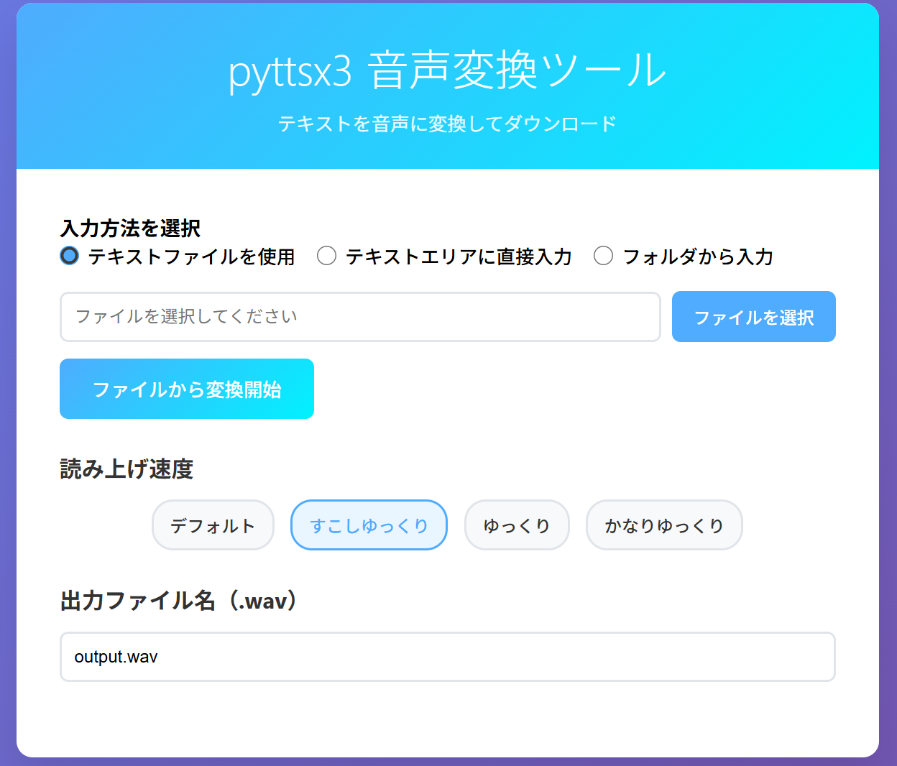

# pyttsx3 テキスト音声変換ツール

Pythonライブラリのpyttsx3を使って、テキストから音声変換したファイルを出力するツールです。



## 特徴

- インストールされるツールの容量は100MB以下と軽量
- 入力テキストはテキストファイルを選択、テキストエリアに直接入力、フォルダ内にあるテキストを全て処理から選択可能
- 2時間以上にわたる長時間の音声合成も作成可能
- 専門用語変換用辞書テキストに単語の読み方を登録することで独自の読み方で音声変換できる
- 仮想環境を構築し実行するようbatファイルを同梱
- ローカル環境で実行

## 機能

- ブラウザベースの直感的なインターフェース
- 3つの入力方法：
  - テキストファイルのアップロード
  - テキストエリアへの直接入力
  - フォルダからの一括処理
- 専門用語の自動カタカナ変換
- 読み上げ速度の調整（4段階）
- 音声ファイルのダウンロード機能

## 環境
- Python 3.9以上（確認済み環境：Windows / Python 3.13.17）
- Flask Webフレームワーク
- pyttsx3 音声合成ライブラリ
- ローカルホスト（localhost:5051）で実行

## セットアップ

### 配置場所と実行権限

- 自分専用のフォルダ（例：`%USERPROFILE%\Git\tts-pyttsx3`）にcloneまたはZIPを展開してください。他の利用者がプログラムを書き換えられる共有フォルダへの配置は避けてください。会社等の管理端末では、配置先の方針を管理者に確認してください。
- `install.bat`・`run_app.bat`は、通常のユーザー権限で実行してください。「管理者として実行」は通常の利用手順に含めません。Python本体やWindows音声機能の導入に管理者の作業が必要な場合は、そのシステム設定と本ツールの実行を分けて扱ってください。
- 保存先のWindowsアクセス権（ACL）は、利用者またはPCの管理者が管理します。開発元のACLはGitHubへの公開・cloneでは引き継がれず、取得先での権限を保証するものではありません。同梱BATはアクセス権の自動変更や管理者への自動昇格を行いません。
- 書き込み権限のエラーが出た場合は、まず自分が書き込める配置先を確認してください。解決のために共有グループへフルコントロールを与えたり、常に管理者権限で起動したりしないでください。別の場所へ移す場合は、移動先で`venv`を新しく作り直してください。

### インストールと起動

1. 必要なパッケージをインストール：
install.batを実行

2. アプリケーションを起動：
run_app.batを実行

3. ブラウザで `http://localhost:5051` にアクセス

通常起動ではデバッグ機能・対話型デバッガ・自動リロードを無効にしています。既存の環境で依存ライブラリを更新する場合は、アプリを終了してから次のコマンドを実行し、`run_app.bat`で起動し直してください。

```powershell
.\venv\Scripts\python.exe -m pip install -r requirements.txt
```

※2回目以降の実行は2以降を実行

## 使用方法

### 入力方法の選択

#### 1. テキストファイルを使用
- ファイル選択ボタンでテキストファイル（.txt, .md）を選択
- ファイルから変換開始ボタンでファイルの内容を読み込んで音声変換
- 音声ファイルをダウンロードボタンで保存ダウンロード

#### 2. テキストエリアに直接入力
- テキストエリアに直接テキストを入力
- リアルタイムで入力内容を確認
- 音声ファイルをダウンロードボタンで保存ダウンロード

#### 3. フォルダから入力
- `input/` フォルダ内のtxtファイルを一括処理
- 各ファイルの元のファイル名に基づいて出力ファイル名を自動生成
- `output/` フォルダに変換されたファイルを出力

### 読み上げ速度設定

4段階の読み上げ速度から選択：
- **デフォルト** (200 wpm)
- **すこしゆっくり** (170 wpm)
- **ゆっくり** (140 wpm)
- **かなりゆっくり** (100 wpm)

### 出力設定

- 出力ファイル名は任意指定。空欄なら日本時間で `20261023-1801.wav` のように自動命名
- 同じ分の自動命名は `20261023-1801-2.wav`、`20261023-1801-3.wav` のように連番を追加
- 自動的に.wav拡張子が追加されます
- フォルダ処理の場合は出力ファイル名の指定は不要

### 処理フロー

#### テキストファイルを使用する場合
1. ファイル選択ボタンでテキストファイルを選択
2. ファイルの存在確認とサイズチェック
3. テキスト読み込み（UTF-8エンコーディング）
4. 専門用語変換処理
5. 音声変換処理
6. 音声ファイルをダウンロードボタンで保存ダウンロード

#### テキストエリアを使用する場合
1. テキストエリアにテキストを入力
2. 文字数制限チェック（最大100,000文字）
3. 専門用語変換処理
4. 音声変換処理
5. 音声ファイルをダウンロードボタンで保存ダウンロード

#### フォルダから入力する場合
1. `input/` フォルダ内のtxtファイルを自動検出
2. 各ファイルを順次処理
3. 専門用語変換処理
4. 音声変換処理
5. `output/` フォルダに保存
6. 処理結果を詳細表示

### 専門用語変換処理
そのままでは読み間違えられる単語を、前処理として指定のカタカナに変換する処理です。

`change_library.txt`を編集することで、専門用語を追加、変更できます。

例：
pyttsx3=パイティーティーエスエックススリー

## 出力

### ファイル・テキスト入力の場合
変換された音声ファイル（.wav形式）が指定したファイル名でダウンロードされます。

Web版では、音声をアプリ専用の一時領域に保存し、生成完了したファイルだけをダウンロード用IDで取得します。同じ出力ファイル名を指定しても、それぞれ別の音声として保存されます。アプリを終了・再起動すると以前のダウンロードIDは利用できなくなるため、必要な音声は終了前にダウンロードしてください。通常終了時は一時領域を削除しますが、強制終了時は残る場合があります。

Webの一時音声は生成完了から24時間、完成済み音声の合計2GiB・100件まで保持します。期限切れはアクセス時と通常起動中の約60秒ごとの掃除で削除し、上限を超える新しい音声を登録するときは古い音声から削除します。再生・ダウンロードで期限は延長しません。期限切れや削除済みのIDは404になります。必要な音声は早めにダウンロードして保存してください。

配信中のファイル等が削除できず保持容量を確保できない場合はHTTP 507で案内し、新しい未登録ファイルを削除します。配信中で削除できなかった期限切れファイルは次回の掃除で再試行します。`app.py` の `AUDIO_TTL_SECONDS`・`MAX_RETAINED_AUDIO_BYTES`・`MAX_RETAINED_AUDIO_FILES` で変更できます。この2GiBは完成後のWeb一時保存の合計上限です。合成中には前述の1ファイル1GiB・ジョブ合計2GiBの制限も適用します。強制終了後の残存ファイルや、別起動プロセスの一時領域はこの掃除の対象外です。

### フォルダ入力の場合
`output/` フォルダに各ファイルの音声ファイルが保存されます。
- 元ファイル名: `sample.txt` → 出力ファイル名: `sample-20261023-1801.wav`
- 同名が存在する場合は `sample-20261023-1801-2.wav` のように連番を追加し、既存ファイルを上書きしません。保存先を排他的に予約するため、同時実行時の衝突も回避します。
- 生成失敗・未作成・空ファイルは成功扱いにせず、新しく作った未完成ファイルを削除します。
- `output/` は利用者の保存先です。Web一時音声の期限・容量による自動削除は適用されません。

## 制限事項

### ローカル画面からの操作確認

Web画面は `http://localhost:5051` または `http://127.0.0.1:5051` で開いてください。接続先のHost・ポートを限定し、他の名前・ポート・IPアドレス（`[::1]` の直接指定を含む）を拒否します。通常起動の待ち受けは引き続きlocalhostのみです。

変換要求は、画面と同じOrigin（通信方式・ホスト・ポート）のみ受け付けます。Originがない場合や`null`の場合も拒否します。画面へ渡した起動ごとのランダムな確認用トークンをJavaScriptが`X-CSRF-Token`ヘッダーに付け、サーバーで照合します。本文やURLにトークンを含めても受け付けません。不正な要求はフォーム解析・ファイル処理・音声合成より前に400または403で拒否し、CORSで他サイトを許可しません。

ログインや合言葉の手入力は不要です。アプリを再起動するとトークンが変わるため、開いたままの画面は再読み込みしてください。ページはキャッシュ保存を抑制し、外部ページのフレームへの埋め込みも拒否します。これらはブラウザ経由の意図しない操作への対策で、同じPC上のプログラムや利用者に対するログイン認証ではありません。別のPCへの公開・複数利用者への提供には別途認証等が必要です。

自作のHTTP呼び出しを利用する場合も、許可URLで画面から取得した現在のトークンと、接続先と一致するOriginヘッダーが必要です。ポート等を変更する場合は、起動設定だけでなく`ALLOWED_HOSTS`・`TRUSTED_HOSTS`も整合させてください。プロキシ用の転送ヘッダーによる迂回は許可しません。

### 入力・保存の上限

- **最大ファイルサイズ**: 500KB
- **最大文字数**: 100,000文字
- **HTTPリクエスト全体**: 1MiB（1,048,576バイト。ファイル・入力項目・区切り情報を含む）
- **フォーム**: 最大10項目、ファイル以外の各項目は400KiBまで
- **入力項目**: `inputType`・`text`・`outputFilename`・`rate`と、ファイル欄`file`のみ。同じ項目の重複送信は不可
- **読み上げ速度**: Web・両CLIとも50～400の整数（音量は0～1の有限の数値）
- **対応ファイル形式**: .txt, .md
- **音声形式**: WAV
- **文字エンコーディング**: UTF-8

容量・項目数の超過はHTTP 413と画面上の案内で通知し、音声合成は開始しません。フォームの検査はmultipartとURLエンコード形式の両方に適用します。ファイルは500KiB（512,000バイト）以下に加えて、内容が100,000文字以内である必要があります。各制限は同時に適用されるため、500KiB以下でも文字数超過なら拒否されます。通常のブラウザ画面はmultipartで送信し、日本語・4バイト文字を含む100,000文字の入力を確認しています。フォーム解析用のバッファにも400KiBの制限が適用されます。

### 変換ジョブの上限

| 項目 | 初期値 |
|---|---|
| 同時実行 | 1件。変換中の追加要求は待ち行列に入れず拒否（Webは429） |
| フォルダ一括処理 | 最大20ファイル・合計500,000文字 |
| 処理時間 | 1ファイル60分、一括処理全体120分 |
| 新たに生成する音声容量 | 1ファイル1GiB、一括処理合計2GiB |
| 保存先の空き容量 | 1GiB未満なら開始せず、処理中に下回った場合も中断 |

同じOSユーザー・同じチェックアウト内のWeb、`cli_tts.py`、`pyttsx3_main.py`を、スレッド内のロックとOSのファイルロックで排他制御します。別のコピーや別ユーザーの実行までは一括制御しません。フォルダ処理は通常のtxtファイル（シンボリックリンクは除外）を対象に、全件の件数・容量・文字数・辞書変換後の文字数を合成前に検査します。合計文字数は各ファイルの変換前後の長い方を加算します。不正な入力がある場合は合成開始前に拒否します。

Web・CLIの入力は共通の文字数・ファイル容量・速度・音量・Windows予約名の検証を行います。辞書変換後も1ファイル100,000文字までです。辞書の各置換前に結果の文字数を計算して超過を拒否し、空のキーも拒否します。CLIの入力ファイルは最大500KiB+1バイトまで読み、超過を検出したら拒否します。`pyttsx3_main.py -o`で明示した出力先も既存ファイルは上書きせず、失敗時には今回予約した未完成ファイルだけを削除します。

音声合成は現在の仮想環境のPythonから子プロセスとして実行し、約0.1秒ごとに経過時間・生成ファイルサイズ・保存先の空きを監視します。時間超過はWebで504、容量・空き不足は507。子プロセスを停止・終了待ちしてから未完成品を削除します。一括処理が途中で制限に達した場合は、完成済みファイルを残し、失敗したファイルと未処理件数を画面に表示します。

時間制限は音声の再生時間ではなく、変換処理にかかる実時間です。2時間以上の音声を一律に拒否する判定は追加していませんが、使用する音声・速度・PCにより上限内で完了するかは異なります。今回の実機確認は短文で、2時間以上の実音声生成は追加試験していません。

`conversion_limits.py`の各定数で上限を変更できます。WebとCLIの文字数・入力容量もこのファイルを基準にし、変更後はアプリを再起動してください。生成量・空き容量の監視はポーリングのため検出までに多少超過することがあり、OSによる厳密なディスク割当・メモリ・CPU制限ではありません。既存の`output/`の累積量や強制終了後の残存物を自動削除する仕組みはありません。

## ファイル構成

```
tts-pyttsx3/
├── app.py                    # Flask Webアプリケーション
├── change_library.txt        # 専門用語変換辞書
├── change_token_katakana.py  # 専門用語変換処理
├── pyttsx3_main.py           # 音声変換処理
├── conversion_limits.py     # 共通の入力・ジョブ制限
├── speech_runner.py         # 音声子プロセスの監視
├── speech_worker.py         # 子プロセスの音声合成
├── error_reporting.py       # エラーIDとローカル診断ログ
├── output_files.py          # 上書き防止と日時命名
├── templates/
│   └── index.html            # Webインターフェース
├── requirements.txt          # 依存関係
├── README.md                 # ReadMeファイル
├── install.bat               # インストールバッチ
├── run_app.bat               # 起動バッチ
├── LICENSE
├── licenses/                 # 依存ライブラリのライセンス
│   ├── pyttsx3_LICENSE.txt
│   ├── Flask_LICENSE.txt
│   └── Werkzeug_LICENSE.txt
├── input/                    # フォルダ処理用入力フォルダ
├── output/                   # フォルダ処理用出力フォルダ
└── venv/                     # 仮想環境（install.bat実行時に作られる）
```

## 技術仕様

- **Webフレームワーク**: Flask 3.1.3
- **音声合成**: pyttsx3 2.99
- **WSGIライブラリ**: Werkzeug 3.1.9
- **フロントエンド**: HTML5, CSS3, JavaScript (ES6+)
- **音声形式**: WAV
- **文字エンコーディング**: UTF-8
- **ポート**: 5051

## トラブルシューティング

### エラーIDと診断ログ

Webの予期しない内部エラーは、画面に定型メッセージと16桁のエラーIDを表示します。直接入力・アップロード・ダウンロードだけでなく、フォルダ処理の各失敗ファイルにもIDを表示します。文字数超過・不正な速度・変換中・時間超過・容量不足等は、引き続き対処方法の分かる案内を表示します。

診断ログは、最初の内部エラー発生時にユーザー専用領域の `%LOCALAPPDATA%\tts-pyttsx3\logs\errors.log` に作成します。1ファイル約1MiB、バックアップ3世代（`.1`～`.3`）を含め合計約4MiBまで保存し、古い記録から入れ替えます。時間による削除は行いません。

ログは1行1件のJSONで、UTCの日時、画面と同じエラーID、処理の種類、例外の型、OS/COMの数値エラーコード、呼び出し位置（ファイルのベース名・関数・行番号）を記録します。入力本文、音声、確認用トークン、リクエスト本文/ヘッダー/URL、ローカル変数、ソース行、絶対パス、元の例外メッセージ全文は記録しません。音声子プロセスのエラーも同じ診断項目だけを親へ渡します。COM障害ではHRESULT等のコードと呼び出し位置を手掛かりに調査できます。

問題が起きた場合は、画面のエラーIDと同じIDをログ内で探してください。ログの保護はユーザー専用領域のアクセス権を利用し、ツールからACLを変更したりログを自動送信したりしません。共有する場合は内容を確認し、必要な記録だけを取り出してください。ログの保存自体に失敗した場合も内部情報を画面へ出さず、空き容量・権限を確認する案内を追加します。

### よくある問題

1. **インストールできない**
   - Python 3.9以降をインストールしているか確認してください（今回の確認環境：Windows / Python 3.13.17）
   - 配置先に自分のユーザーで書き込めるか確認してください。共有フォルダや保護された場所の場合は、自分専用のフォルダへ配置し直してください
   - ターミナルのエラー内容を確認してください。管理端末の制限は管理者に相談し、権限を広げて回避しないでください

2. **音声ファイルが生成されない**
   - システムの音声ドライバーが正しくインストールされているか確認
   - フォルダ入力では`output/`、Webの直接入力・ファイル入力では自分の一時フォルダに書き込めるか確認してください
   - ターミナルのエラー内容を確認してください。Windows音声機能の導入・修復が必要な場合は管理者に相談し、ツール自体は通常権限で実行してください

3. **ファイルアップロードエラー**
   - ファイルサイズが500KB以下か確認
   - 対応形式（.txt, .md）か確認
   - UTF-8エンコーディングで保存されているか確認

4. **フォルダ処理エラー**
   - `input/` フォルダが存在するか確認
   - フォルダ内にtxtファイルがあるか確認
   - ファイルがUTF-8エンコーディングで保存されているか確認

5. **change_library.txtを書き換えたのに反映されない**
   - 実行中のアプリなどを全て閉じ、起動しなおしてみてください

6. **文字数やファイルサイズの上限を変えたい**
   - conversion_limits.pyのMAX_TEXT_LENGTHで最大文字数、MAX_INPUT_BYTESで最大ファイル容量を設定できます。app.pyのMAX_REQUEST_SIZEで要求全体、MAX_FORM_FIELD_SIZEとMAX_FORM_PARTSでフォームの容量・項目数を設定できます。変更後は関連する上限の整合性を確認してアプリを再起動してください。

## ライセンス
このプロジェクトはMITライセンスの下で公開されています。

## License

- **本プロジェクト本体**: MIT License (see [LICENSE](./LICENSE))
- **Dependencies**:
  - `pyttsx3` – Mozilla Public License Version 2.0 (see [licenses/pyttsx3_LICENSE.txt](./licenses/pyttsx3_LICENSE.txt))  
  - `Flask` – BSD 3-Clause License (see [licenses/Flask_LICENSE.txt](./licenses/Flask_LICENSE.txt))  
  - `Werkzeug` – BSD 3-Clause License (see [licenses/Werkzeug_LICENSE.txt](./licenses/Werkzeug_LICENSE.txt))

---

## ライセンスについて

本プロジェクトでは依存ライブラリのライセンス条件を遵守するため、上記フォルダに全文を同梱しています。  
再頒布や二次利用の際には、各ライセンス条項（著作権表示・免責事項）を必ず維持してください。

## CLI（コマンドライン）からの利用方法

本ツールはWebブラウザだけでなく、CLI（コマンドライン）からも音声変換が可能です。

### 使い方

1. 変換したいテキストファイル（UTF-8形式）を `input/` フォルダに配置します。
2. 下記コマンドを実行します。

```sh
python cli_tts.py 入力ファイル名 [--rate 読み上げ速度]
```

- `入力ファイル名` : `input/` フォルダ内のファイル名（例: `test2.txt`）
- `--rate` : 読み上げ速度（50～400、指定しない場合は170）

#### 例
```sh
python cli_tts.py test2.txt --rate 200
```

- `input/test2.txt` を読み込み、専門用語変換を行い、
- 読み上げ速度200で音声合成
- `output/test2-20261023-1801.wav` のような日時付きの新規ファイルとして保存

### 出力
- 出力ファイルは `output/` フォルダに、元の名前＋日本時間の日時＋`.wav` で保存されます。
- 例: `input/sample.txt` → `output/sample-20261023-1801.wav`。同名があれば連番を付け、上書きしません。
- 合成失敗・空ファイルでは非ゼロ終了し、未完成の新規ファイルを削除します。

### 終了コードと標準出力
- 成功時: `[OK] ...` と表示し、終了コード0
- 失敗時: `[ERROR] ...` と表示し、終了コードが1以上
- 呼び出し元のバッチや他プログラムからも成否判定が可能です

### 注意事項
- 入力ファイルはUTF-8エンコーディングで保存してください
- ファイルサイズや文字数の上限はWeb版と同じです
- 専門用語変換は `change_library.txt` の内容が反映されます

---
